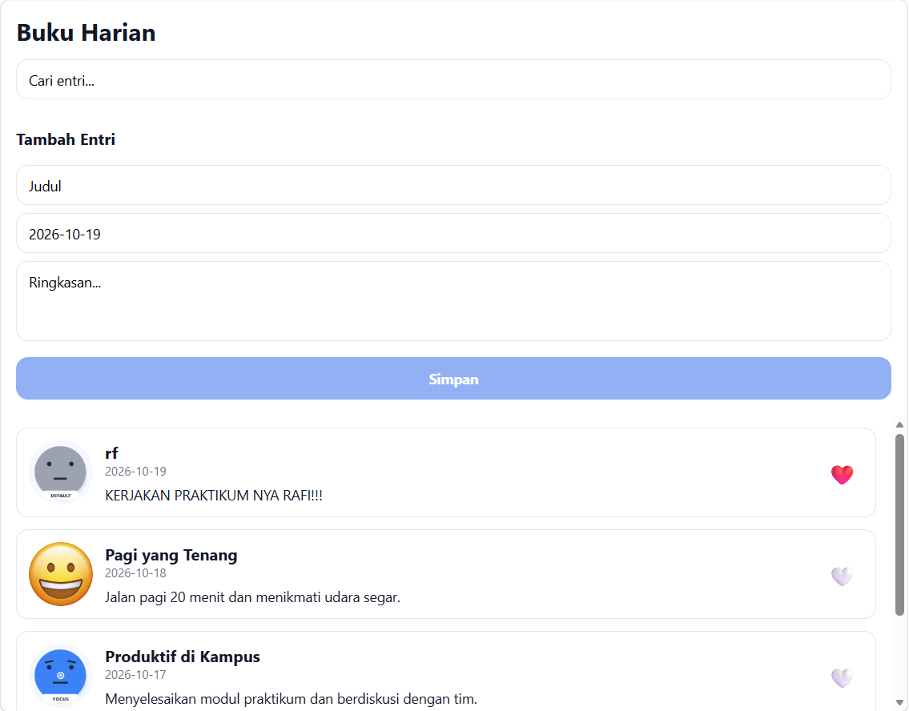
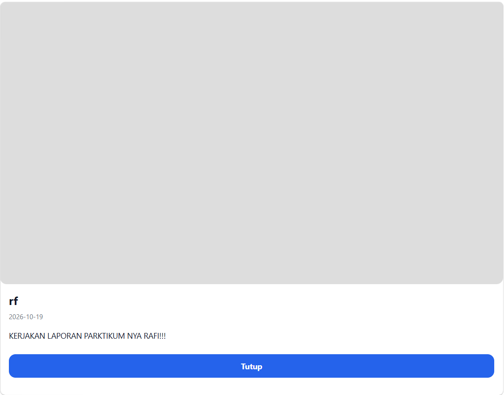
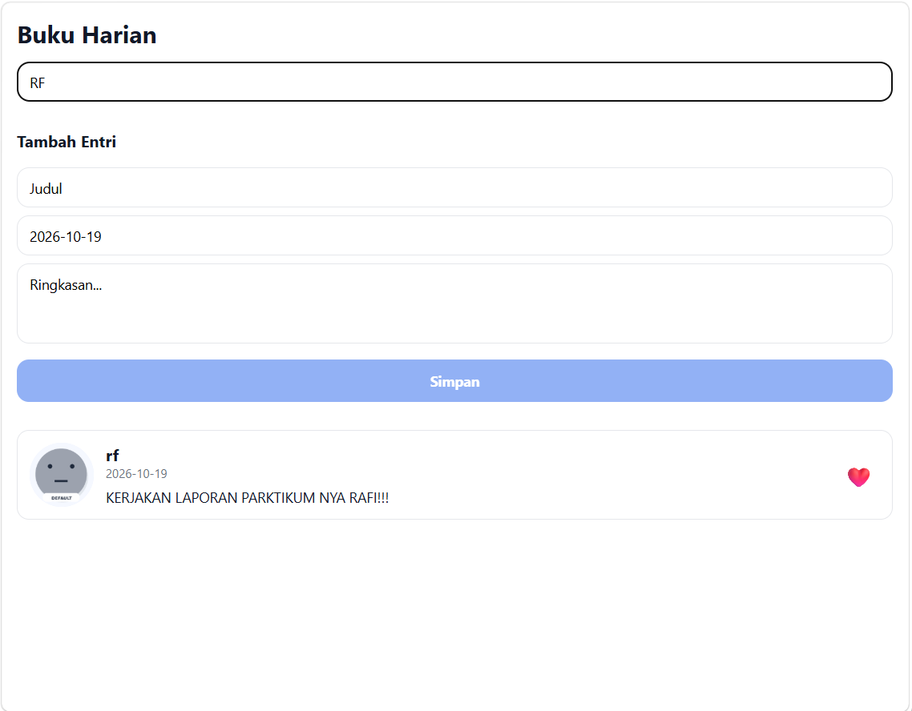

# Diary App (Buku Harian)

- **Nama:** Rafi Akmal Permana
- **NIM:** 2430511065

Aplikasi buku harian sederhana dengan Expo / React Native.

## Menjalankan proyek

1. Pastikan Node.js sudah terpasang.
2. Install dependency: `npm install`
3. Jalankan: `npx expo start`
4. Scan QR dengan **Expo Go**, atau tekan `a` untuk emulator Android (`i` untuk iOS simulator, `w` untuk web).

## Fitur yang diselesaikan

- `DiaryCard` sebagai presentational component yang menerima data dan callback lewat props (`src/components/DiaryCard.js`).
- `SearchBar` dengan local state dan callback `onChange` ke parent (`src/components/SearchBar.js`).
- `EntryForm` sebagai controlled form yang menambahkan entri ke state `entries` (`src/components/EntryForm.js`).
- `DiaryListScreen` mengelola state `entries`, `query`, `likedIds`, dan `selected` (`src/screens/DiaryListScreen.js`).
- Status like berubah langsung tanpa me-reload aplikasi.
- Gambar mood memakai gambar lokal dari `assets/moods` (`happy`, `focus`, `calm`, `default`).
- Dua entri baru ditambahkan lewat form saat pengujian.

## Penggunaan props dan state

**Props**

- `DiaryCard` menerima `title`, `date`, `preview`, `moodImage`, `liked`, serta callback `onPress` dan `onToggleLike`. Komponen ini tidak punya state sendiri.
- `SearchBar` menerima `placeholder` dan callback `onChange`.
- `EntryForm` menerima callback `onSubmit` yang mengirim entri baru ke parent.

**State**

- `SearchBar` menyimpan teks ketikan di state `queryText`, lalu memanggil `onChange` agar parent ikut menerima nilainya.
- `EntryForm` menyimpan `title`, `date`, dan `preview` sebagai controlled form. Tombol Simpan aktif setelah judul dan ringkasan terisi.
- `DiaryListScreen` mengelola:
  - `entries`: daftar entri, entri baru masuk di urutan teratas.
  - `query`: kata kunci pencarian, daftar disaring dengan `useMemo` berdasarkan judul, ringkasan, dan tanggal.
  - `likedIds`: kumpulan id entri yang disukai.
  - `selected`: entri yang sedang dibuka di modal detail.

## Screenshot

**Tambah entri dan like.** Entri baru "rf" muncul di urutan teratas, ikon suka berubah menjadi ❤️.

**Modal detail.** Menekan kartu membuka detail entri, tombol Tutup menutupnya.

**Pencarian.** Kata kunci "RF" menyaring daftar menjadi satu entri.

